# Retail Sales Analytics \| Python, SQL & Power BI

An end-to-end **Retail Sales Analytics** portfolio project using Python,
Pandas, MySQL, and Power BI. The project follows a **Bronze → Silver →
Gold Medallion Architecture** to explore raw retail transactions, clean
and prepare the data, create business summaries, validate key metrics,
and present sales insights in an interactive dashboard.

> **Project status:** Python exploration and cleaning, Gold business
> summaries, MySQL analysis, Power BI dashboard, and city-based
> Row-Level Security have been developed. A Gemini-powered
> natural-language data chatbot is a planned future enhancement and is
> not part of the current completed feature set.

## Table of Contents

-   [Project Overview](#project-overview)
-   [Business Questions](#business-questions)
-   [Technology Stack](#technology-stack)
-   [Data Pipeline](#data-pipeline)
-   [Medallion Architecture](#medallion-architecture)
-   [Dataset](#dataset)
-   [Repository Structure](#repository-structure)
-   [Power BI Dashboard](#power-bi-dashboard)
-   [Key Metrics](#key-metrics)
-   [SQL Analysis](#sql-analysis)
-   [Row-Level Security](#row-level-security)
-   [How to Run](#how-to-run)
-   [Skills Demonstrated](#skills-demonstrated)
-   [Future Enhancements](#future-enhancements)
-   [Disclaimer](#disclaimer)

## Project Overview

The objective of this project is to analyze retail sales performance
across products, categories, cities, customers, and time. It
demonstrates a practical data analyst workflow, from raw CSV exploration
to a cleaned dataset, SQL-based business analysis, and a Power BI
reporting experience.

The cleaned transaction-level Silver dataset is the central source for
business analysis and the Power BI model. Gold contains aggregated
business-report CSV outputs for focused analysis.

## Business Questions

This project is designed to answer questions such as:

1.  What is the total revenue and how many orders were placed?
2.  Which product categories generate the most revenue?
3.  Which cities contribute the most to sales?
4.  How does revenue change month by month?
5.  Which products generate the highest sales?
6.  What is the average order value?
7.  How many orders were returned, and what is the return rate?
8.  How do sales results compare across customer segments?

## Technology Stack

  -----------------------------------------------------------------------
  Technology                          Purpose
  ----------------------------------- -----------------------------------
  Python                              Data analysis workflow

  Pandas                              Data exploration, cleaning,
                                      transformation, and aggregation

  Jupyter Notebook                    Organizing the analysis into
                                      reproducible steps

  MySQL                               Storing the cleaned data and
                                      running SQL analysis

  Power BI Desktop                    Data model, DAX measures, and
                                      dashboard development

  Power BI Service                    Publishing and sharing the report

  DAX                                 KPI calculations and analytical
                                      measures

  CSV                                 Dataset and business-report storage
  -----------------------------------------------------------------------

## Data Pipeline

The pipeline below describes the workflow implemented in this project.
GitHub renders this Mermaid diagram directly in the README.

``` mermaid
flowchart LR
    A["Bronze Layer<br/>Raw retail_sales.csv"] --> B["01 · Data Exploration<br/>Shape, types, nulls, duplicates"]
    B --> C["02 · Silver Layer<br/>Cleaning and standardization"]
    C --> D["Cleaned Transaction Data<br/>retail_sales_clean.csv"]
    D --> E["MySQL Database<br/>retail_sales table"]
    D --> F["03 · Gold Layer<br/>Business aggregations"]
    E --> G["SQL Analysis<br/>Revenue, orders, returns"]
    F --> H["Gold Business Reports<br/>Category · City · Month · Product"]
    G --> I["KPI Validation"]
    H --> J["Power BI Data Model"]
    I --> J
    J --> K["DAX Measures<br/>KPIs and calculations"]
    K --> L["Power BI Dashboard"]
    L --> M["Power BI Service<br/>Published Report"]
    M --> N["City-Based Row-Level Security"]
```



### Pipeline stages

  -----------------------------------------------------------------------
  Stage                   What happens            Output
  ----------------------- ----------------------- -----------------------
  1\. Bronze              Preserve and inspect    Raw retail CSV
                          the original source     
                          file                    

  2\. Exploration         Inspect dimensions,     Exploration notebook
                          data types, missing     
                          values, and duplicates  

  3\. Silver              Clean, standardize, and Cleaned CSV
                          validate transaction    
                          records                 

  4\. SQL                 Import Silver data into SQL result sets
                          MySQL and run business  
                          queries                 

  5\. Gold                Aggregate sales by      Business-report CSVs
                          category, city, month,  
                          and product             

  6\. Power BI            Build the model, DAX    PBIX report
                          measures, and dashboard 

  7\. Service and         Publish the report and  Published Power BI
  security                test city-based RLS     report
  -----------------------------------------------------------------------

## Medallion Architecture

### Bronze --- Raw Data

-   Stores the original retail sales CSV.
-   Serves as the source for exploration and cleaning.
-   Is preserved without overwriting the original source.

### Silver --- Cleaned Data

The Silver layer contains the cleaned transaction-level dataset. The
cleaning workflow includes:

-   Identifying and removing duplicate records.
-   Handling missing customer name, age, discount, city, and
    payment-method values.
-   Reconstructing missing discount values using available transaction
    amounts.
-   Standardizing city, category, and payment-method values.
-   Converting order dates to a date type.
-   Checking the final data for missing values and duplicate rows.

The recorded final cleaned dataset contains **5,000 rows and 16
columns**, with no remaining missing values or duplicate rows.

### Gold --- Business Reports

The Gold layer contains aggregated outputs designed for business
analysis:

-   Category-level sales
-   City-level sales
-   Monthly sales trends
-   Product-level sales

These outputs are stored as CSV files. The Silver transaction-level
dataset remains available for flexible filtering and detailed Power BI
analysis.

## Dataset

The project dataset contains retail transaction records.

  Attribute                Details
  ------------------------ ------------------------------------
  Original source rows     5,020
  Duplicate rows removed   20
  Cleaned records          5,000
  Columns                  16
  Date range               1 January 2023 -- 31 December 2025
  Data type                Synthetic retail sales data

### Dataset columns

`order_id`, `order_date`, `customer_id`, `customer_name`, `gender`,
`age`, `product`, `category`, `quantity`, `unit_price`, `discount`,
`total_amount`, `city`, `payment_method`, `return_status`,
`customer_segment`

## Repository Structure

The intended repository structure is:

``` text
Retail-Sales-Analytics/
│
├── data/
│   ├── bronze/
│   │   └── retail_sales.csv
│   ├── silver/
│   │   └── retail_sales_clean.csv
│   └── gold/
│       └── business_reports/
│           ├── category_sales.csv
│           ├── city_sales.csv
│           ├── monthly_sales.csv
│           └── product_sales.csv
│
├── notebooks/
│   ├── 01_bronze_data_exploration.ipynb
│   ├── 02_silver_data_cleaning.ipynb
│   └── 03_gold_business_analysis.ipynb
│
├── sql/
│   └── retail_sales_analysis.sql
│
├── powerbi/
│   ├── Retail_Sales_Dashboard.jpg
│
├── README.md
├── requirements.txt
└── .gitignore
```

**Important:** Align this structure with the actual files you commit. In
your current VS Code Explorer, the Gold CSVs are under
`data/quality_reports/`, and there is also a
`data/gold/retail_sales.csv` plus a root-level `retail_sales.csv`.
Before uploading, check what each extra CSV contains. Keep one clearly
named canonical raw source in Bronze, the cleaned transaction file in
Silver, and the aggregated reports in `data/gold/business_reports/`. Do
not delete a file until you have confirmed it is a duplicate or
unnecessary.

## Power BI Dashboard

The Power BI report provides an interactive overview of retail sales
performance.

### Dashboard contents

-   KPI cards for revenue, orders, quantity, average order value, and
    return rate.
-   Revenue by product category.
-   Monthly sales trend.
-   Revenue by city.
-   Category-level performance detail table.
-   Filters and interactive report exploration.

### Dashboard preview

Add your actual exported dashboard screenshot at
`powerbi/images/dashboard_overview.png` and retain the following image
reference:


### Open the report

-   **Interactive Power BI report:** [Open the published
    dashboard](https://app.powerbi.com/links/bPTHWwb9Sn?ctid=88f944d0-1278-45f9-88d8-dc81b5f77b17&pbi_source=linkShare)
-   **Downloadable report:** `powerbi/Retail_Sales_Dashboard.pdf`
-   **Power BI project file:** `powerbi/Retail_Sales_Dashboard.pbix`

The Power BI link may require the viewer to sign in or have permission.
Check its access settings before sharing it publicly. Do not enable
public access if the report contains data or information that should
remain restricted.

## Key Metrics

The following are the project reference values recorded from the Power
BI dashboard:

  KPI                              Value
  --------------------- ----------------
  Total Revenue           ₹85,931,174.16
  Total Orders                     5,000
  Total Quantity Sold              9,787
  Average Order Value         ₹17,186.23
  Returned Orders                    369
  Return Rate                      7.38%

The Total Quantity card may display as **10K** because of visual
rounding; the underlying value is **9,787**.

Run the SQL validation query against the final MySQL table before
treating these figures as verified release values.

## SQL Analysis

The cleaned Silver CSV was imported into MySQL as the `retail_sales`
table. SQL analysis includes aggregations such as revenue by category,
city, and month, along with overall KPI validation.

Example --- revenue by category:

``` sql
SELECT
    category,
    ROUND(SUM(total_amount), 2) AS total_revenue
FROM retail_sales
GROUP BY category
ORDER BY total_revenue DESC;
```

Example --- overall KPI validation:

``` sql
SELECT
    ROUND(SUM(total_amount), 2) AS total_revenue,
    COUNT(DISTINCT order_id) AS total_orders,
    SUM(quantity) AS total_quantity,
    ROUND(
        SUM(total_amount) / COUNT(DISTINCT order_id), 2
    ) AS average_order_value,
    COUNT(DISTINCT CASE
        WHEN return_status = 'Returned'
        THEN order_id
    END) AS returned_orders,
    ROUND(
        COUNT(DISTINCT CASE
            WHEN return_status = 'Returned'
            THEN order_id
        END) * 100.0
        / COUNT(DISTINCT order_id), 2
    ) AS return_rate
FROM retail_sales;
```

## Row-Level Security (RLS)

Dynamic city-based Row-Level Security was configured and tested in Power
BI using a user-to-city access table.

The intended behavior is that a report viewer sees rows for the city
mapped to their signed-in identity.

**Deployment considerations:**

-   Replace all fictional sample identities with actual authorized
    organizational identities.
-   Assign the correct users to the RLS role in Power BI Service.
-   RLS restrictions apply to workspace Viewers; workspace Admins,
    Members, and Contributors have elevated access and are not
    restricted in the same way.
-   Never publish real user emails or access-control data in the public
    repository.

## How to Run

### 1. Clone the repository

``` bash
git clone https://github.com/YOUR-USERNAME/Retail-Sales-Analytics.git
cd Retail-Sales-Analytics
```

### 2. Set up Python

Create and activate a virtual environment if desired:

``` bash
python -m venv .venv
```

Windows PowerShell:

``` powershell
.venv\Scripts\Activate.ps1
```

Install the project dependencies:

``` bash
python -m pip install -r requirements.txt
```

The notebooks use Pandas and Jupyter. If they are not already listed in
`requirements.txt`, add:

``` text
pandas
jupyter
```

### 3. Run the notebooks

Open the project in VS Code or Jupyter and run the notebooks in order:

1.  `01_bronze_data_exploration.ipynb`
2.  `02_silver_data_cleaning.ipynb`
3.  `03_gold_business_analysis.ipynb`

The notebooks expect the dataset paths shown in the repository
structure. Keep those paths consistent if you reorganize the folders.

### 4. Import the Silver data into MySQL

Import `data/silver/retail_sales_clean.csv` into MySQL Workbench and
create a table named `retail_sales`. Then execute the queries in
`sql/retail_sales_analysis.sql`.

### 5. Open the Power BI report

Open `powerbi/Retail_Sales_Dashboard.pbix` in Power BI Desktop.
Configure the data connection for your own environment if required.

## Skills Demonstrated

-   Data exploration and data-quality checks
-   Data cleaning and transformation with Pandas
-   Bronze, Silver, and Gold Medallion Architecture
-   SQL aggregation and business analysis
-   KPI calculations and DAX
-   Power BI data modelling and dashboard development
-   Data validation across Python, SQL, and Power BI
-   Power BI Service publishing
-   Dynamic Row-Level Security concepts

## Future Enhancements

-   Add a Gemini API-powered chatbot that answers natural-language
    questions using validated queries against the retail dataset.
-   Add automated data-quality tests and a repeatable refresh workflow.
-   Add a data dictionary and business requirements document.
-   Expand the dashboard with deeper customer and product analysis.
-   Add further documented business recommendations.

## Disclaimer

This is a portfolio learning project built with synthetic retail data.
The dataset and resulting figures are for educational and demonstration
purposes and do not represent the performance of a real company.
